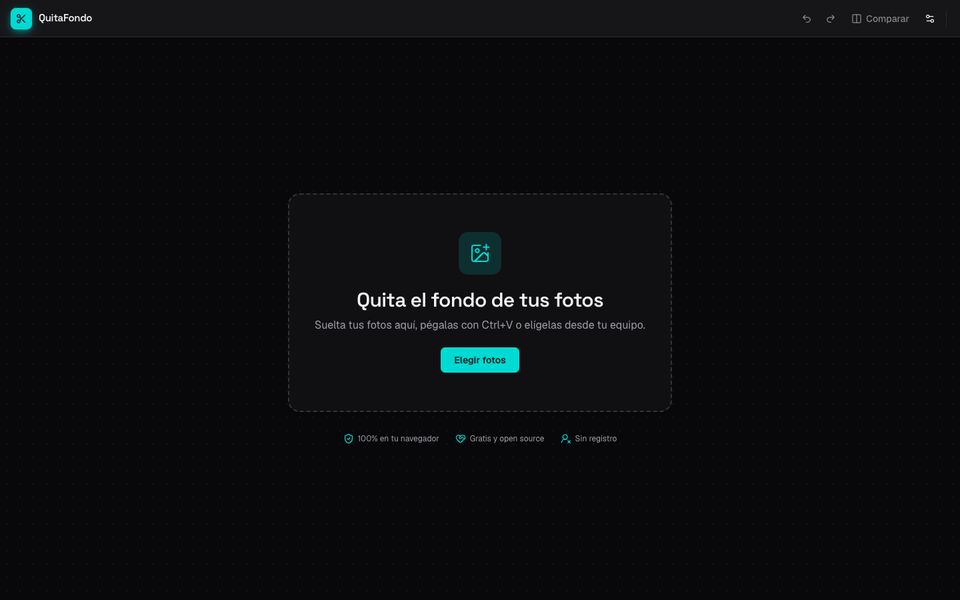
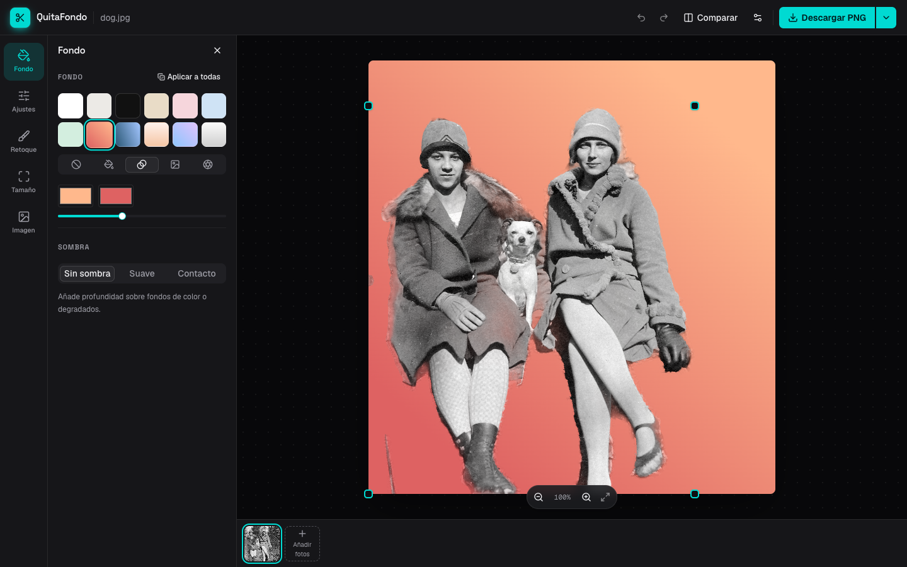
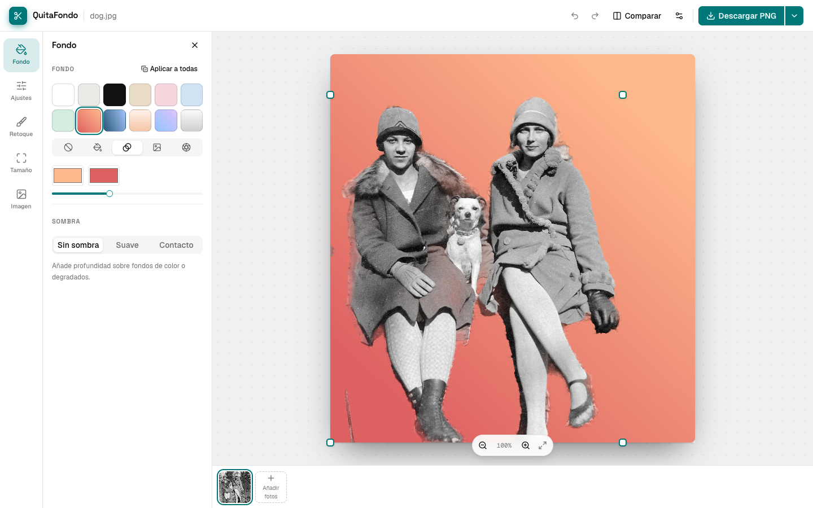

# QuitaFondo

**Español** · [English](#english)

[](https://github.com/3rikml/quitafondo/actions/workflows/ci.yml)
[](./LICENSE)



QuitaFondo es un editor de imágenes en el navegador para quitar el fondo de fotos, reencuadrarlas y exportarlas en lote. Todo el procesamiento ocurre **100% en el cliente** (WebGPU/WebAssembly): no hay backend, no se suben imágenes a ningún servidor y no se requiere ninguna API key.

| Tema oscuro | Tema claro |
| --- | --- |
|  |  |

## Privacidad

Tus fotos **nunca salen de tu equipo**. El modelo de IA se descarga una sola vez desde Hugging Face y corre dentro de tu navegador; después la app funciona incluso sin internet.

## Funcionalidades

- **Quitar fondo automáticamente** con IA, en un Web Worker para que la interfaz nunca se congele. Usa WebGPU cuando está disponible y WebAssembly si no. Después afina el contorno con los colores de la propia foto (pelo y bordes más nítidos) y elimina las manchas semitransparentes que el modelo deja en el fondo.
- **Recorte de máxima calidad** (opcional, en Preferencias): en equipos sin una GPU compatible con el mejor modelo, como los Mac con Apple Silicon, usa BEN2 para conservar mejor el pelo y los bordes, a cambio de ~1 min por foto y ~220 MB de descarga.
- **Pega (Ctrl/Cmd+V) o arrastra** imágenes a cualquier parte de la ventana; la imagen se abre sola mientras se procesa.
- **Comparar antes/después** con un deslizador sobre el lienzo.
- **Fondos**: galería de colores y degradados, color o degradado personalizado, tu propia imagen o la **foto original desenfocada** (efecto retrato).
- **Sombras** suave o de contacto, con intensidad ajustable.
- **Reencuadrar y centrar el sujeto**, con presets (cuadrado, retrato 4:5, historia 9:16) o un tamaño personalizado.
- **Recorte**, **mover, redimensionar y rotar** el sujeto directamente sobre el lienzo.
- **Selección mágica con un clic** (SlimSAM): haz clic en un objeto para quitarlo del recorte, agregarlo de vuelta o **quedarte solo con él** (útil con varias personas u objetos), y elige entre 3 tamaños de selección.
- **Borrador mágico** (LaMa): pinta sobre algo de la foto —una persona al fondo, un logo, una mancha— y la IA lo borra rellenando el hueco.
- **Luz y color**: brillo, contraste, saturación y temperatura del sujeto, y un botón para **armonizarlo con el fondo** elegido.
- **Bordes finos**: suavizar, contraer/expandir y quitar el halo de color del fondo original.
- **Retoque manual** (borrar/restaurar) con pincel, incluyendo un modo "inteligente" por flood-fill. Un círculo bajo el puntero muestra el tamaño real del pincel, que empieza proporcional a la foto.
- **Mejora de resolución (upscaling) 2x** con Swin2SR en el mismo worker, por mosaicos, sin congelar la interfaz.
- **Zoom y desplazamiento** del lienzo: Ctrl/⌘ + rueda o pellizco hacia el puntero (hasta 800%), rueda o Espacio + arrastrar para mover, y pellizco con dos dedos en el celular.
- **Deshacer/rehacer** por imagen.
- **Descarga en 1 clic** y **exportación en lote (ZIP)** a PNG, JPG o WebP.
- **Instalable (PWA) y funciona sin conexión** después de la primera visita.
- **Interfaz en español e inglés**, según el idioma del navegador o con el botón del encabezado.
- **Interfaz de editor profesional**: tema oscuro (o claro), barra de herramientas (Fondo, Ajustes, Retoque, Tamaño, Imagen), tira de miniaturas y hoja inferior en el celular.
- Persistencia local (IndexedDB) para no perder el trabajo al recargar.

## Atajos de teclado

| Tecla | Acción |
| --- | --- |
| `1` – `5` | Abrir herramienta (Fondo, Ajustes, Retoque, Tamaño, Imagen) |
| `B` | Activar/desactivar retoque |
| `[` `]` | Tamaño del pincel |
| `C` | Comparar antes/después |
| `D` | Descargar |
| `Ctrl/⌘ + Shift + C` | Copiar imagen |
| `Ctrl/⌘ + Z` · `Ctrl/⌘ + Shift + Z` | Deshacer · Rehacer |
| `Ctrl/⌘ + V` | Pegar una imagen |
| `Ctrl/⌘ + rueda` · `+` `−` `0` | Acercar/alejar · ajustar a la pantalla |
| `Espacio + arrastrar` | Mover la vista |
| `Esc` | Salir de la herramienta |

## Empezar

Requisitos: Node.js 20+ y npm.

```bash
npm install
npm run dev
```

Abre [http://localhost:3000](http://localhost:3000).

```bash
npm run build   # build de producción
npm run start   # sirve el build de producción (incluye el service worker)
npm run lint    # ESLint
npm run test    # pruebas (Vitest)
npm run test:e2e  # pruebas end-to-end (Playwright, sobre el build; detén `npm run dev` antes)
```

Lo que sigue está en la [hoja de ruta](./ROADMAP.md).

## Cómo funciona

```
Imagen ──► Web Worker (lib/ai/ai.worker.ts)
              │  Transformers.js + ONNX Runtime Web
              │  WebGPU ─► BiRefNet_lite   (GPUs compatibles)
              │  WebGPU ─► IS-Net          (Apple Silicon)
              │  WASM   ─► IS-Net          (sin GPU / respaldo)
              ▼
         recorte PNG ──► afinado del borde y limpieza (lib/image/edgeMatting.ts, ghostCleanup.ts)
                     ──► EditorCanvas (fondo, sombra, encuadre, retoque) ──► PNG/JPG/WebP/ZIP
```

- `lib/ai/client.ts`: cliente del worker. Si WebGPU falla en plena inferencia, reemplaza el worker, corre esa tarea en WASM y lo recuerda para la próxima visita.
- `lib/image/drawSubject.ts`: dibuja sujeto y sombra; lo comparten la vista previa y la exportación para que coincidan píxel a píxel.
- `public/sw.js`: service worker que guarda la app para usarla sin conexión.

## Modelos de IA

| Modelo | Licencia | Cuándo se usa |
| --- | --- | --- |
| [BiRefNet_lite](https://huggingface.co/onnx-community/BiRefNet_lite-ONNX) | MIT | GPUs con WebGPU que soportan el modelo (mejor calidad) |
| [IS-Net general-use](https://huggingface.co/imgly/isnet-general-onnx) | MIT (pesos originales Apache-2.0) | Apple Silicon y equipos sin WebGPU |
| [BEN2](https://huggingface.co/onnx-community/BEN2-ONNX) | MIT | Opción «Recorte de máxima calidad» en equipos sin GPU compatible con BiRefNet (~219 MB, CPU) |
| [Swin2SR lightweight x2](https://huggingface.co/Xenova/swin2SR-lightweight-x2-64) | Apache-2.0 | "Mejorar calidad" (fotos de hasta ~1 MP) |
| [SlimSAM](https://huggingface.co/Xenova/slimsam-77-uniform) | Apache-2.0 | Selección mágica con un clic |
| [LaMa](https://huggingface.co/Carve/LaMa-ONNX) | Apache-2.0 | Borrador mágico (~208 MB, CPU) |

## Stack técnico

- [Next.js](https://nextjs.org) (App Router) + React + TypeScript
- [Transformers.js](https://github.com/huggingface/transformers.js) (ONNX Runtime Web) para quitar fondos y mejorar la calidad
- Tailwind CSS, Base UI, Vitest, Playwright

## Contribuir

¡Las contribuciones son bienvenidas! Lee [CONTRIBUTING.md](./CONTRIBUTING.md) y el [Código de Conducta](./CODE_OF_CONDUCT.md).

## Licencia

MIT — ver [LICENSE](./LICENSE).

---

<a id="english"></a>

# QuitaFondo (English)

[](https://github.com/3rikml/quitafondo/actions/workflows/ci.yml)
[](./LICENSE)


QuitaFondo is an in-browser image editor to remove photo backgrounds, reframe subjects and batch-export the results. Everything runs **100% client-side** (WebGPU/WebAssembly): no backend, no uploads, no API keys.

| Dark theme | Light theme |
| --- | --- |
|  |  |

## Privacy

Your photos **never leave your device**. The AI model is downloaded once from Hugging Face and runs inside your browser; after that the app even works offline.

## Features

- **Automatic background removal** with AI in a Web Worker, so the UI never freezes. Uses WebGPU when available, WebAssembly otherwise. It then sharpens the outline with the photo's own colors (crisper hair and edges) and removes the translucent patches the model leaves on the background.
- **Maximum quality cutout** (optional, in Preferences): on machines without a GPU that fits the best model, such as Apple Silicon Macs, it uses BEN2 to keep hair and edges better, at ~1 min per photo and a ~220 MB download.
- **Paste (Ctrl/Cmd+V) or drop** images anywhere; the image opens right away while it is processed.
- **Before/after comparison** slider.
- **Backgrounds**: preset colors and gradients, custom color/gradient, your own image, or the **blurred original photo** (portrait effect).
- **Soft or contact shadows** with adjustable intensity.
- **Reframe and center** with presets (square, 4:5 portrait, 9:16 story) or a custom size; crop, move, resize and rotate on the canvas.
- **One-click magic selection** (SlimSAM): click an object to remove it from the cutout, add it back or **keep only it** (handy with several people or objects), with 3 selection sizes to choose from.
- **Magic eraser** (LaMa): paint over something in the photo — a person in the back, a logo, a stain — and the AI removes it, filling the gap.
- **Light & color**: brightness, contrast, saturation and temperature of the subject, plus a button to **match it to the chosen background**.
- **Fine edges**: soften, shrink/grow and remove the old background's color halo.
- **Manual retouch** (erase/restore) brush with a "smart" flood-fill mode. A circle under the pointer shows the brush's real size, which starts proportional to the photo.
- **2x upscaling** with Swin2SR in the same worker, tile by tile, without freezing the UI.
- **Zoom and pan** the canvas: Ctrl/⌘ + wheel or pinch toward the pointer (up to 800%), wheel or Space + drag to move, two-finger pinch on phones.
- Per-image **undo/redo**.
- **One-click download** and **batch ZIP export** as PNG, JPG or WebP.
- **Installable PWA that works offline** after the first visit.
- **Spanish and English interface**, following the browser language or the header toggle.
- **Professional editor UI**: dark (or light) theme, tool rail (Background, Adjust, Retouch, Size, Image), filmstrip, and a bottom sheet on phones.
- Local persistence (IndexedDB) so a reload never loses your work.

## Getting started

Requires Node.js 20+ and npm.

```bash
npm install
npm run dev
```

Open [http://localhost:3000](http://localhost:3000). See the commands, keyboard shortcuts and architecture overview in the Spanish section above, and what comes next in the [roadmap](./ROADMAP.md).

## AI models

| Model | License | Used on |
| --- | --- | --- |
| [BiRefNet_lite](https://huggingface.co/onnx-community/BiRefNet_lite-ONNX) | MIT | WebGPU adapters that can run it (best quality) |
| [IS-Net general-use](https://huggingface.co/imgly/isnet-general-onnx) | MIT (original weights Apache-2.0) | Apple Silicon and devices without WebGPU |
| [BEN2](https://huggingface.co/onnx-community/BEN2-ONNX) | MIT | "Maximum quality cutout" option on machines whose GPU cannot run BiRefNet (~219 MB, CPU) |
| [Swin2SR lightweight x2](https://huggingface.co/Xenova/swin2SR-lightweight-x2-64) | Apache-2.0 | "Improve quality" (photos up to ~1 MP) |
| [SlimSAM](https://huggingface.co/Xenova/slimsam-77-uniform) | Apache-2.0 | One-click magic selection |
| [LaMa](https://huggingface.co/Carve/LaMa-ONNX) | Apache-2.0 | Magic eraser (~208 MB, CPU) |

## Contributing

Contributions are welcome! Please read [CONTRIBUTING.md](./CONTRIBUTING.md) and the [Code of Conduct](./CODE_OF_CONDUCT.md). Issues and pull requests in English or Spanish are both fine.

## License

MIT — see [LICENSE](./LICENSE).
